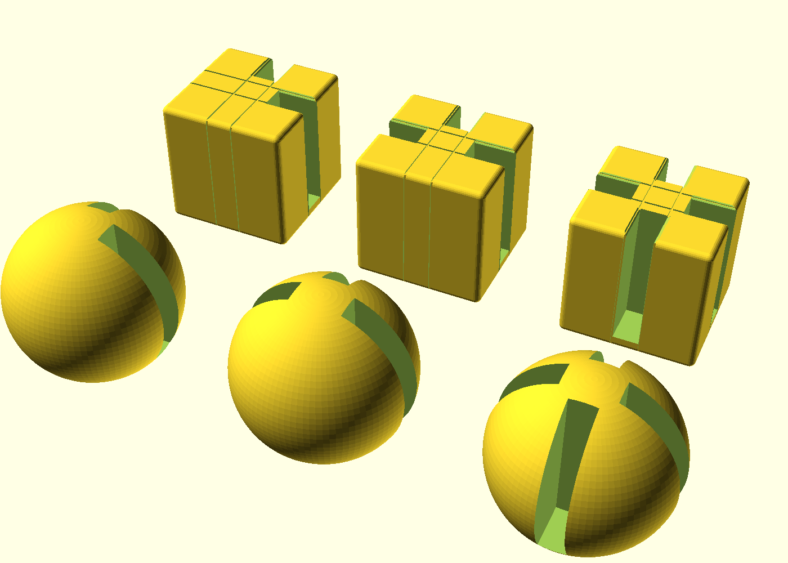
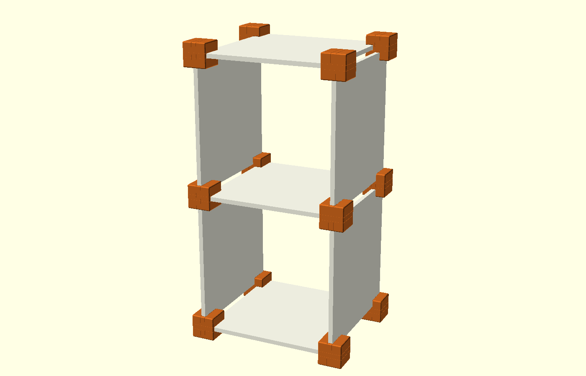
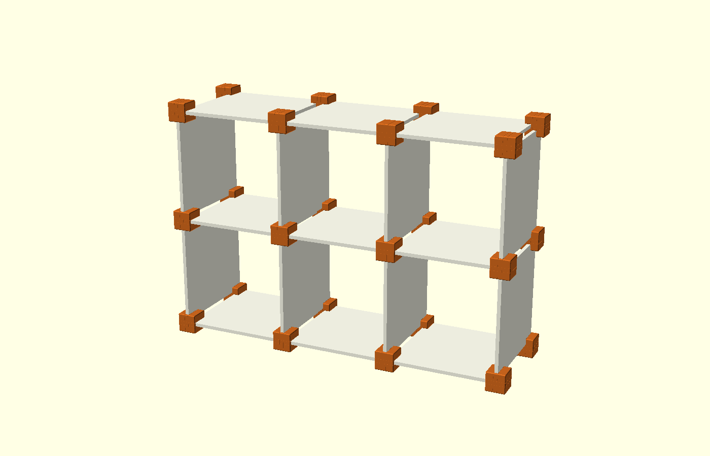
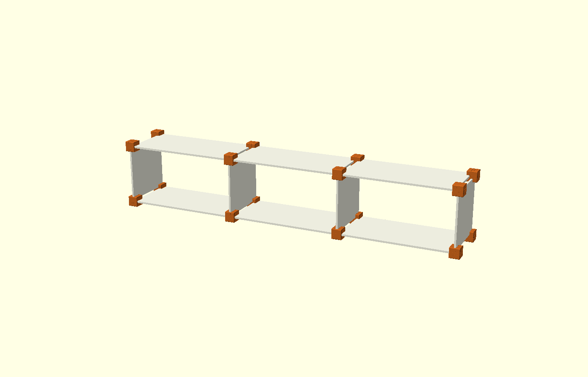
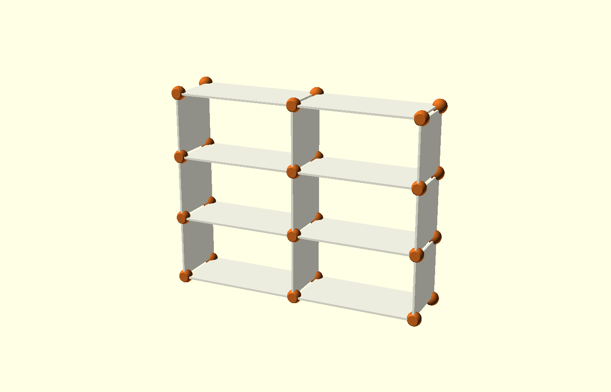

# Конектори за шкафове от керамични плочки (10 mm)

Параметричен модел за 3D принтер. Конекторът е куб или сфера с канали, в които влизат
плочките. Плътната челна стена ги спира да не се изместват напред/назад. На всяко
кръстовище се слагат два конектора – един отпред и един отзад (един и същ детайл).



## Детайли за печат

| Файл | Къде се ползва | Размер (mm) |
|---|---|---|
| `stl/cube_L.stl`, `stl/sphere_L.stl` | външен ъгъл на шкафа (2 плочки) | куб 56, сфера Ø70 |
| `stl/cube_T.stl`, `stl/sphere_T.stl` | ръб – под, таван, страница (3 плочки) | същите |
| `stl/cube_X.stl`, `stl/sphere_X.stl` | вътрешно кръстовище (4 плочки) | същите |

- `connector.scad` – изходен модел; форма, размер на куба/сферата, дебелина на плочката
  и хлабина са параметри.
- `cabinet.scad` – сглобка за преглед: задаваш брой клетки и размер на плочките.

Каналът е 10.6 mm (плочка 10 mm + 0.6 mm хлабина). Плочката навлиза ~18 mm в куба
(~25 mm в сферата) и ~50 mm в дълбочина. В центъра има плътно ядро 20.6 mm, затова:

- стъпка на решетката = дължина на плочката + 20.6 mm
- плочките **не се режат** – ползват се в стандартния си размер

## Предложения със стандартни плочки

Дълбочината на шкафа е 30 cm (късата страна на плочката) + 1 cm. Тегло: 30 × 30 ≈ 2 kg,
30 × 60 ≈ 4 kg.

| Шкаф | Клетки | Плочки | Конектори (общо) | Външен размер Ш × В (cm) |
|---|---|---|---|---|
| Нощно шкафче | 1 × 2 | 7 × (30×30) | 8 L, 4 T | 38 × 70 |
| Етажерка | 3 × 2 | 17 × (30×30) | 8 L, 12 T, 4 X | 102 × 70 |
| ТВ шкаф | 3 × 1 | 6 × (30×60) + 4 × (30×30) | 8 L, 8 T | 192 × 38 |
| Стелаж | 2 × 3 | 8 × (30×60) + 9 × (30×30) | 8 L, 12 T, 4 X | 130 × 102 |

Нощно шкафче (30×30) | Етажерка (30×30)
---|---
 | 

ТВ шкаф (30×60 + 30×30) | Стелаж със сфери (30×60 + 30×30)
---|---
 | 

Други размери: 20 × 20 и 30 × 30 са най-стабилни. 60 × 60 дава шкаф, дълбок 60 cm – става
за нисък шкаф на един ред. 60 × 120 не препоръчвам за рафт (твърде голям отвор между опорите).

Собствен вариант за преглед:

```
openscad -D cols=4 -D rows=2 -D tile_w=600 -D tile_h=300 -D 'shape="sphere"' cabinet.scad
```

## Печат

- Ориентация: плоската челна страна върху масата, без подпори (сферата е отрязана под 45°).
- Материал: PETG (или ASA); PLA пълзи под постоянен товар.
- 4–5 периметъра, 30–40 % запълване, слой 0.2 mm.
- Първо отпечатай един `L` и пробвай с реална плочка. Ако е стегнато или хлабаво,
  смени `clearance` (или `tile`) в `connector.scad`:

```
openscad -o stl/cube_X.stl -D 'shape="cube"' -D 'type="X"' -D 'clearance=0.8' connector.scad
```

## Важно за безопасността

- Конекторите държат плочките на място, но не спират шкафа да се „срине“ настрани.
  Сложи гръб (напр. ХДФ) или закрепи шкафа към стената, особено над 2 реда.
- Рафт 60 cm: до около 15–20 kg равномерен товар. Керамиката се чупи внезапно, без предупреждение.
- Ползвай гранитогрес, не тънък фаянс, за хоризонталните рафтове.
- За по-стегнато захващане сложи капка силикон или парче филц в канала.
