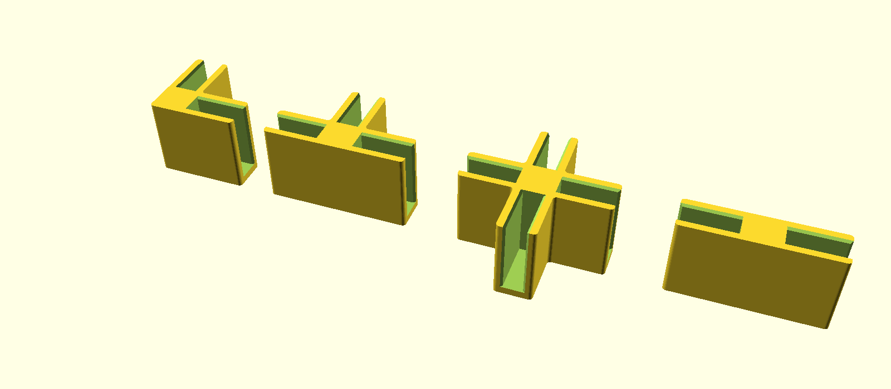

# Конектори за шкафове от керамични плочки (10 mm)

Параметричен модел за 3D принтер. Плочките влизат в U-образни канали на конектора,
а челната стена ги спира да не се изместват напред/назад. На всяко кръстовище се слагат
два конектора – един отпред и един отзад (един и същ детайл, обърнат огледално).



## Файлове

| Файл | Къде се ползва | Размер (mm) |
|---|---|---|
| `stl/connector_L.stl` | външен ъгъл на шкафа (2 плочки) | 50.6 × 50.6 × 44 |
| `stl/connector_T.stl` | ръб – под, таван, страница (3 плочки) | 80.6 × 50.6 × 44 |
| `stl/connector_X.stl` | вътрешно кръстовище (4 плочки) | 80.6 × 80.6 × 44 |
| `stl/connector_I.stl` | снаждане на две плочки в една равнина | 80.6 × 20.6 × 44 |
| `connector.scad` | изходен модел (OpenSCAD) – всички размери са параметри | |

Пример: шкаф 2 × 2 клетки иска отпред 4 × L, 4 × T, 1 × X и още толкова отзад.

## Размери на плочките

Каналът е 10.6 mm (плочка 10 mm + 0.6 mm хлабина), стените са 5 mm, плочката навлиза
30 mm в рамото и 40 mm в дълбочина. Централното ядро е 20.6 mm, затова:

- стъпка на решетката = дължина на плочката + 20.6 mm
- светъл отвор на клетката = дължина на плочката − 10 mm (приблизително)

Плочките не се режат – ползват се в стандартния си размер (напр. 30 × 30, 30 × 60, 60 × 60).

## Печат

- Ориентация: челната (плоската) страна върху масата, без подпори.
- Материал: PETG (или ASA); PLA пълзи под постоянен товар.
- 4–5 периметъра, 40 %+ запълване, слой 0.2 mm.
- Първо отпечатай един `L` и пробвай с реална плочка. Ако е стегнато или хлабаво,
  смени `clearance` в `connector.scad` (или `tile`, ако плочката не е точно 10 mm).

Нов STL от командния ред:

```
openscad -o stl/connector_X.stl -D 'type="X"' -D 'tile=10' -D 'clearance=0.6' connector.scad
```

## Важно за безопасността

- Керамиката е тежка (60 × 60 × 1 cm ≈ 8 kg). Конекторите държат плочките на място,
  но не спират шкафа да се „срине“ настрани. Сложи гръб (напр. ХДФ, залепен/завинтен отзад)
  или закрепи шкафа към стената, особено над 2 реда.
- За по-стегнато захващане сложи капка силикон или парче филц в канала.
- Ползвай гранитогрес, не тънък фаянс, за хоризонталните рафтове.
